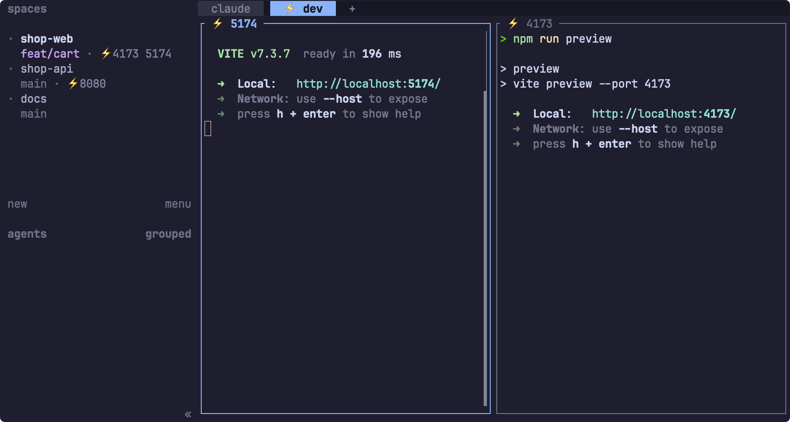

# herdr-port-labels

See which herdr Space, tab, and pane has a dev server running: ⚡ on the tab, the port on the pane border, and the ports of each Space in the sidebar.



Any TCP listener started from a pane counts, whatever the command: `vite`, `next dev`, `rails server`, `ssh -L`, `kubectl port-forward`, `node --inspect`. Servers that an agent such as Claude Code starts inside its pane count too. The plugin only displays. It never stops a process.

## Install

1. Install the plugin:

   ```sh
   herdr plugin install ooospooky/herdr-port-labels
   ```

   The build step runs `node --version` and nothing else. It downloads nothing.

2. Add `"$dev_servers"` to a Space row in `~/.config/herdr/config.toml`. Keep the rows you already have. With the default rows, the result is:

   ```toml
   [ui.sidebar.spaces]
   rows = [["state_icon", "workspace"], ["branch", "git_status", "$dev_servers"]]
   ```

   To color the ports, write the token as a table: `{ token = "$dev_servers", fg = "#a6e3a1" }`.

3. Check the config and reload the running server:

   ```sh
   herdr config check && herdr server reload-config
   ```

4. Open a new pane. The watcher starts on the next `pane.created` event, or when the herdr server starts, not at install time.

Requirements:

- herdr 0.9.0 or later. Tested on 0.9.5.
- Node.js 22.18 or later. `scripts/with-node.sh` skips Node 23.0 to 23.5, because those versions strip TypeScript types only behind a flag. No npm dependencies at run time.
- `lsof`. macOS ships it. On Debian and Ubuntu, run `apt install lsof`.
- macOS or Linux.

## What you see

- **Tab.** `⚡ dev`. The prefix goes when the last server in that tab stops.
- **Pane border.** `⚡ 5174`, or `⚡ 5174 | api` when you named the pane `api`. herdr draws borders only around split panes. For a lone pane, set `ui.pane_borders = "always"`.
- **Sidebar.** The row of the Space, which the API calls a workspace, lists every port in that Space after a ⚡. A Space without a server shows nothing there.

## What it detects

A TCP port in the `LISTEN` state whose process descends from a pane's shell. The watcher runs `lsof -nP -iTCP -sTCP:LISTEN` and `ps -A -o pid=,ppid=`, then walks each listener's parent chain up to a pane shell. It never looks at the command name.

It does not detect:

- Servers started outside herdr, for example from a VS Code terminal, launchd, or systemd.
- Servers that left the pane's process tree: `setsid`, `pm2`, and anything else that daemonizes.
- Ports published by Docker containers. The listener belongs to the Docker daemon, not to your pane.
- Listeners owned by another user. `lsof` lists only your own processes unless it runs as root.

Known limitations:

- A tab that still had its default number, such as `2`, comes back as a fixed `2` when the mark goes. It no longer renumbers when tabs move or close. herdr has no API that restores automatic numbering.
- A tab or pane whose own name contains `⚡ ` counts as already marked and never gets a second mark. A name that starts with `⚡ ` loses that prefix when a server in it stops.
- The sidebar token stops at 80 characters. Past that it shows the first ports and `+n`.

## With herdr-automatic-rename and herdr-pane-id

Tested together on herdr 0.9.5. [herdr-automatic-rename](https://github.com/qu8n/herdr-automatic-rename) keeps its `[N] ` jump-key prefix in front, so a marked tab reads `[2] ⚡ zsh`, and it treats the marked tab as manually renamed until you run its `reset` action. [herdr-pane-id](https://github.com/imtim/herdr-pane-id) appends its pane id, so a server pane reads `⚡ 5199 | p2` or `⚡ 5199:p2`, and the label settles after one round. Both work because the watcher leaves alone a label that already carries the ⚡ and the pane's ports, so no rename loop can start.

## How it works

The `[[startup]]` hook and every `pane.created` event run `scripts/with-node.sh src/ensure-watch.ts`. `ensure-watch.ts` starts one `src/watch.ts` per herdr server. It replaces the watcher when the plugin version or install path changes, so an update takes over when the next pane opens. The watcher subscribes to herdr's pane, tab, and workspace events, scans every 5 seconds and 300 ms after an event, and writes the difference through `tab.rename`, `pane.rename`, and `workspace.report_metadata`. The sidebar token has a 25 second TTL, so it also disappears when the watcher dies. The watcher exits when herdr goes away or the plugin is disabled or removed. It logs to `watch.log` in `~/.local/state/herdr/plugins/ooospooky.port-labels`, or the same path under `$XDG_STATE_HOME`.

## If nothing shows up

- **No marks after the install.** Open a new pane, then run `herdr plugin log list --plugin ooospooky.port-labels`. A line that starts with `port-labels: needs Node 22.18` means the hook found no usable Node. herdr starts hooks with its own `PATH`, so `scripts/with-node.sh` also looks in the fnm, nvm, volta, mise, asdf, Homebrew, and `~/.local/bin` locations. If your Node lives elsewhere, start herdr from a shell where `node --version` works.
- **The sidebar stays empty.** `$dev_servers` is missing from the `[ui.sidebar.spaces]` rows, or the server has not reloaded the config.
- **`spawn lsof ENOENT` in `watch.log`.** Install `lsof`.

## Uninstall

```sh
herdr plugin uninstall ooospooky.port-labels
```

`herdr plugin disable` and, for a linked checkout, `herdr plugin unlink` work the same way. The watcher notices within 5 seconds, restores the labels it changed, and exits. The `"$dev_servers"` entry can stay in `config.toml`. It renders nothing.

## Develop

```sh
npm install
npm test
herdr plugin link /path/to/herdr-port-labels
```

`npm test` runs `tsc --noEmit` and the `node --test` suite. Open a new pane so the hook starts the watcher from your checkout. After a code change, send `SIGTERM` to the running `watch.ts` and open a new pane, because `ensure-watch.ts` replaces a watcher only when its version or install path differs.

## License

MIT. Not an official herdr plugin.
